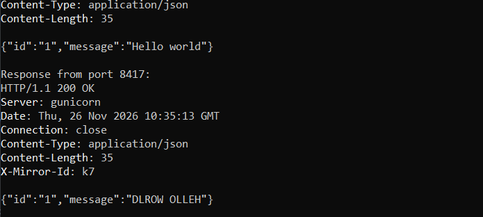

# Microservice challenge

Two Flask services running on Kubernetes with HTTPS.

See [answer.md] for implementation details.

I used Flask for both services and Gunicorn to serve HTTPS. The hello service returns the original JSON. The mirror service calls hello using its Kubernetes service name, reverses the message using Python slicing and converts it to uppercase. It preserves the ID and adds the X-Mirror-Id header to Flask responses.

Both applications run in Kind as Deployments with ClusterIP Services. cert-manager creates a local CA and issues certificates for both services. The mirror verifies the hello certificate using the CA certificate mounted in its container. Neither application listens on a plain HTTP port.

## Run locally

Install Docker, Kind, kubectl, Bash, curl and base64 on WSL or Linux. I installed this on my WSL . Create two public Docker Hub repositories named `hello` and `mirror` under your account.

## bash commands
docker login
export DOCKERHUB_USER=your-dockerhub-username
chmod +x script.sh
./script.sh

The script creates a Kind cluster, builds and pushes both images, installs cert-manager, deploys the services and prints their HTTPS responses using temporary port forwards. It switches kubectl to the Kind context. The forwards close when the script exits.

Expected hello response: `{"id":"1","message":"Hello world"}`

Expected mirror response: `{"id":"1","message":"DLROW OLLEH"}` with header `X-Mirror-Id: k7`. Uppercase and port 8417 follow the additional requirements in the challenge comment.

## Design notes

The containers run as non-root users, with resource limits and HTTPS health probes. The mirror uses a request timeout and returns 502 if the upstream request fails. The health probes use TLS but Kubernetes does not verify their certificates, the actual service request does verify the certificate.

For a real cluster, use its registry and a trusted certificate issuer, increase replicas as needed and arrange certificate reloads or pod restarts after renewal. The local CA is intended for this demo.

Python, YAML and Bash syntax were checked. Live deployment still needs to be tested with Docker and Kind.

## Docker Repo Hello

## Terminal Output

## Kubernetes object check Terminal

## Hello Application

## Mirror Application

## By- Om Bhagat
